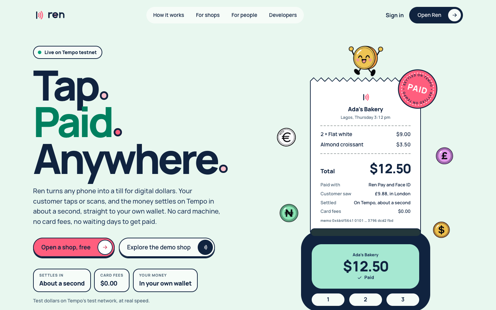
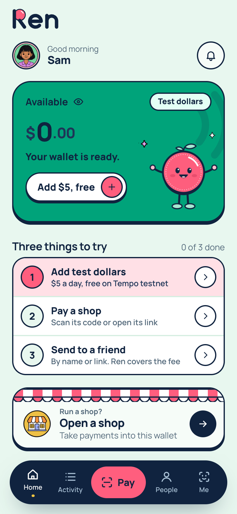
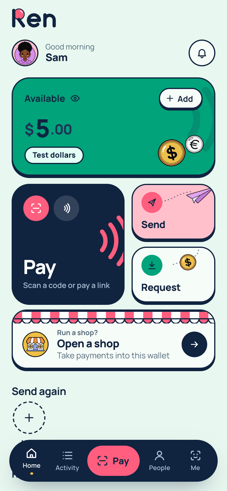
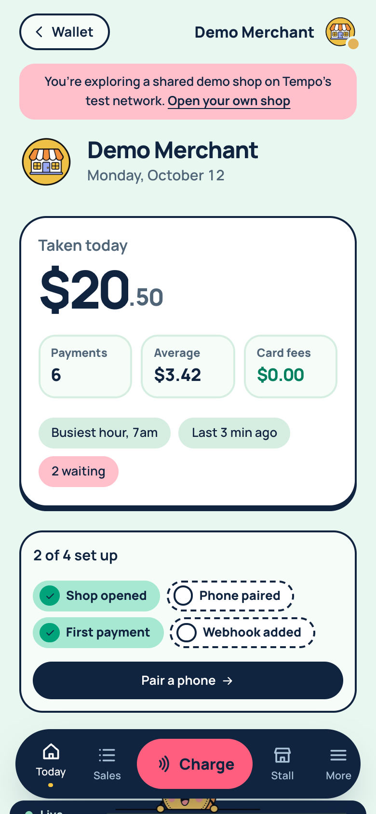
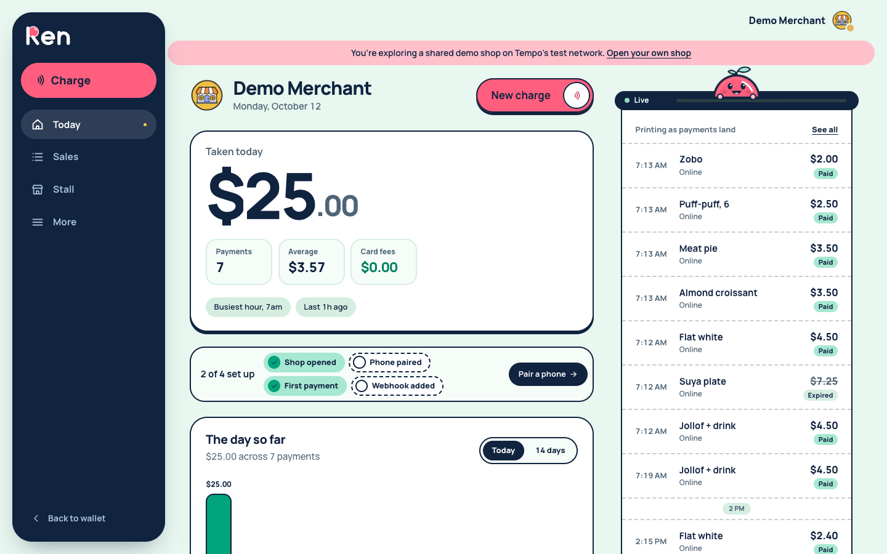
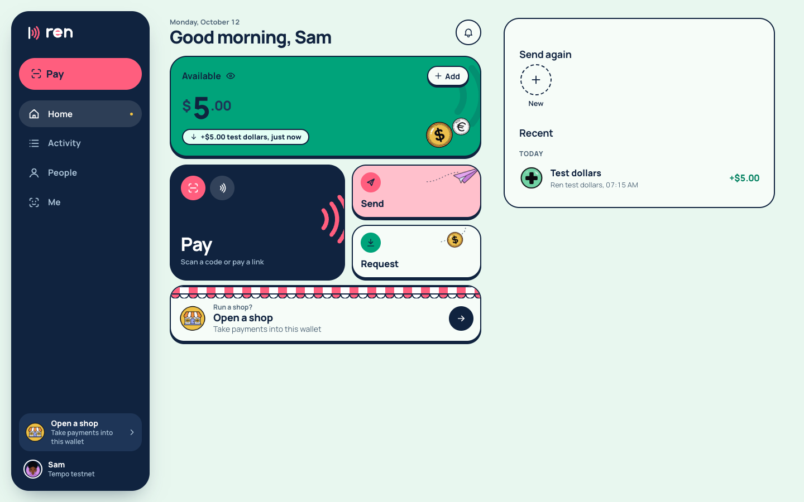
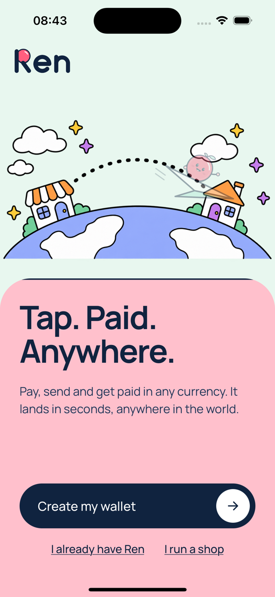
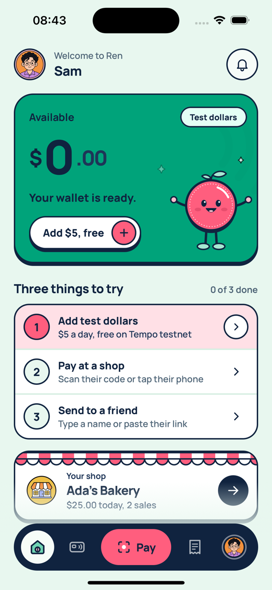
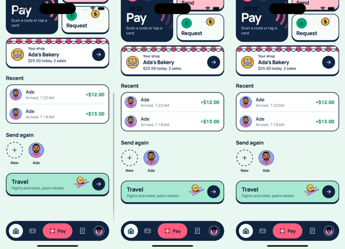
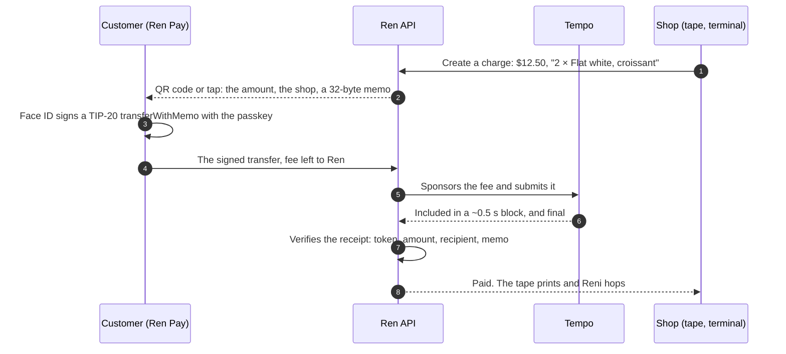

<p align="center">
  <picture>
    <source media="(prefers-color-scheme: dark)" srcset="docs/brand/ren-lockup-reversed.svg">
    
  </picture>
</p>

<h3 align="center">Tap. Paid. Anywhere.</h3>

<p align="center">
  Ren turns any phone into a till for digital dollars. Your customer taps or scans, and the money
  settles on <a href="https://tempo.xyz">Tempo</a> in about a second, straight to your own wallet.<br>
  No card machine, no card fees, no waiting days to get paid.
</p>

<p align="center">
  <a href="https://web-production-acdb.up.railway.app"><b>Open the live app</b></a> ·
  <a href="#try-it-in-two-minutes">Try it in two minutes</a> ·
  <a href="https://api-production-a594b.up.railway.app/health">API health</a> ·
  <a href="DECISIONS.md">Decisions</a>
</p>

<p align="center">
  <sub>Built for Colosseum's Crypto World's Fair, Tempo track. Live on Tempo testnet: test dollars, real speed.</sub>
</p>

<p align="center">
  
</p>

## What Ren is

One network behind a wallet, a terminal, a card and an API.

| | For | What it does |
|---|---|---|
| **Ren Pay** | people | A dollar wallet in your browser and on your phone. Pay a shop by scanning or tapping, send to anyone by name or link, and see every amount in dollars, euros, pounds or naira. Your passkey is the key: no seed phrase, and nothing to install on the web. |
| **Ren Terminal** | shops | Any phone becomes the card machine. Pair it with a one-time code; staff phones get a key that can only take payments. |
| **Shop dashboard** | shops | Today's takings, live. Payments print on a receipt tape the second they land, with the on-chain proof one click away. |
| **Stalls** | shops | Your menu on a link and a QR code. People order and pay from their own phones, from anywhere. |
| **Ren Card** | people | An NFC card that pays with a limited Tempo access key: a daily limit, an expiry, and a freeze that stops the next tap. |
| **Developers** | builders | Payment intents, signed webhooks and secret keys, so any website or till software can take Ren payments. |

Ren is non-custodial. Money moves from the customer's address to the shop's address, and Ren
never holds it. What Ren adds is the layer around the transfer: who may spend, how much, where
and on whose behalf, plus the network fee, so nobody needs a gas token to pay for lunch.

## Screens

<table>
  <tr>
    <td width="33%"></td>
    <td width="33%"></td>
    <td width="33%"></td>
  </tr>
  <tr>
    <td><sub><b>First run.</b> A new wallet gets one button to add test dollars, and three things to try.</sub></td>
    <td><sub><b>Wallet.</b> The dollars roll in like a till's wheels, and money that just landed gets a chip.</sub></td>
    <td><sub><b>Shop.</b> Taken today, live, with $0.00 in card fees.</sub></td>
  </tr>
</table>





**On iOS.** The same wallet and the shop's till, in the Expo app:

<table>
  <tr>
    <td width="33%"></td>
    <td width="33%"></td>
    <td width="33%" valign="top"></td>
  </tr>
  <tr>
    <td><sub><b>Welcome.</b> One passkey, no seed phrase.</sub></td>
    <td><sub><b>First run</b> on iOS.</sub></td>
    <td><sub><b>Home.</b> Your shop's day and who just paid you.</sub></td>
  </tr>
</table>

## Try it in two minutes

1. Open **[the live app](https://web-production-acdb.up.railway.app)** and choose **Explore the demo shop**. You land on a shop's dashboard and its live tape.
2. Choose **Charge**, type an amount and start the charge. A QR code appears.
3. On your phone, open the same site and choose **Create my wallet**. Face ID or your fingerprint makes the passkey. Then **Add $5, free**.
4. Tap **Pay** and scan the code, or point your phone's camera at it. The charge flips to **Paid** in about a second, and the payment prints on the shop's tape.

Everything runs on Tempo's Moderato testnet with test dollars. Ren pays every network fee.

## How a payment works



Every payment carries the charge's id in its memo. That is how an on-chain transfer is matched to
an order without Ren sitting in the middle of the money, and why a payment Ren never submitted is
still recognised by the chain watcher.

**A card, a phone and an agent are the same thing here:** a P-256 key registered as a Tempo
access key on the owner's account, with an expiry, a spending limit and a scope.

## What Ren uses from Tempo

| Tempo feature | How Ren uses it |
|---|---|
| TIP-20 `transferWithMemo` | Every payment names its charge in a 32-byte memo, so matching needs no custody |
| Fee sponsorship | Ren's relayer pays the network fee in dollars; customers never hold a gas token |
| P-256 and WebAuthn signatures | Passkey wallets on the web and in the app, and cards that sign with P-256 |
| Access keys with limits | Cards and staff phones hold keys with a spending limit, an expiry and a freeze |
| ~0.5 s blocks, deterministic finality | Paid means paid: no confirmations to wait for, no reorg to unwind |
| Dollar stablecoins | Prices, balances and settlement in dollars (AlphaUSD on testnet, USDC on mainnet) |

## Measured, not estimated

On Tempo Moderato, 2026-09-22:

| | |
|---|---|
| Payment, end to end through Ren's relay | 1.07–1.18 s |
| Gas for a payment | 51,495 (≈ $0.00003 on mainnet) |
| Gas for a shop's first ever payment | 300,795 (≈ $0.0002) |
| Card-signed payment | 83,782 gas |

## Why it exists

Ren is for anyone who gets paid, anywhere. A bakery in Lagos, a record shop in Brooklyn and a
kitchen in Accra all lose a cut to card rails, wait days to be paid out, and can't easily take
money from a customer visiting from another country. Ren settles in about a second, for a
fraction of a cent, in dollars that hold their value, and the customer sees the price in their
own currency.

It is not pitched as cheaper local money where local transfers are already instant and free. It
is for what those rails cannot do:

- **Holding dollars,** not a currency that loses value between sale and rent.
- **Money from anywhere,** paid the same way by the customer next door and the one abroad.
- **No merchant fee,** against 1.5% and more on card rails.
- **Payments by software.** An AI agent gets the same kind of spending credential as a person:
  a limited key with a budget, a shop allowlist, and approval above a threshold.

The first pilot is in Nigeria, where 25.9m people already hold stablecoins, around 60% of
sub-Saharan stablecoin inflows arrive, and card rails charge shops 1.5% + ₦100. The research is
in [`docs/market`](docs/market).

## Design

Ren's look is called Soda: mint paper, green for money at rest, watermelon for paying, navy ink,
2px ink outlines, and a solid ink shadow that buttons press into. Type is Manrope, with tabular
figures so amounts never jump. The logo is the R coin: a capital R whose bowl is a coin, sitting
on the same ink shadow. Reni, a watermelon coin with a sprout, shows up when money moves. Every screen is built
for a phone first and gets a real desktop layout. Text meets WCAG contrast on its background,
and every animation stops for people who ask for reduced motion.

## The repo

| Path | What it is |
|---|---|
| [`apps/web`](apps/web) | Next.js: the landing page, Ren Pay on the web, the shop dashboard, the charge screen, stalls |
| [`apps/mobile`](apps/mobile) | Expo (React Native): Ren Pay and Ren Terminal for iOS |
| [`apps/api`](apps/api) | Hono: payment intents, the sponsored relay, settlement, the chain watcher, webhooks |
| [`packages/tempo`](packages/tempo) | Tempo primitives: networks, tokens, the memo, receipt verification, card signatures |
| [`packages/db`](packages/db) | Postgres schema, migrations and client (Drizzle) |
| [`docs/tempo`](docs/tempo) | The research the build rests on, measured against live Tempo |
| [`docs/card`](docs/card) | The card applet protocol |
| [`DECISIONS.md`](DECISIONS.md) | Why things are the way they are |

Ren was called Kova until October 2026. Internal package names and protocol identifiers keep the
old name (`@kova/*`, the `Kova-Signature` webhook header, `kova_test_sk_…` keys), so existing
integrations keep working.

## Running it

Needs Node 22+, pnpm 10 and a local Postgres.

```bash
pnpm install
createdb kova_dev
pnpm --filter @kova/db migrate

# a testnet fee payer, funded from the faucet, plus a demo shop and an API key
pnpm --filter @kova/api setup:dev

pnpm --filter @kova/api dev     # http://localhost:4000
pnpm --filter @kova/web dev     # http://localhost:3000
```

Then open the dashboard, start a charge, and pay it from another terminal:

```bash
pnpm --filter @kova/api pay:open
```

The charge screen flips to Paid on its own. Each app's `.env.example` lists what it reads.

## Tests

```bash
pnpm test
```

Unit tests cover the memo format, amount parsing, receipt verification and card signatures. The
end-to-end tests run against Tempo's Moderato testnet with its public faucet, and prove the real
path: a sponsored payment settles and verifies, a card access key with a daily limit pays,
freezing it blocks the next tap, and a payment Ren never submitted is still picked up by the
watcher.

```bash
pnpm --filter @kova/tempo test:e2e
pnpm --filter @kova/api test
```

## License

[MIT](LICENSE).
